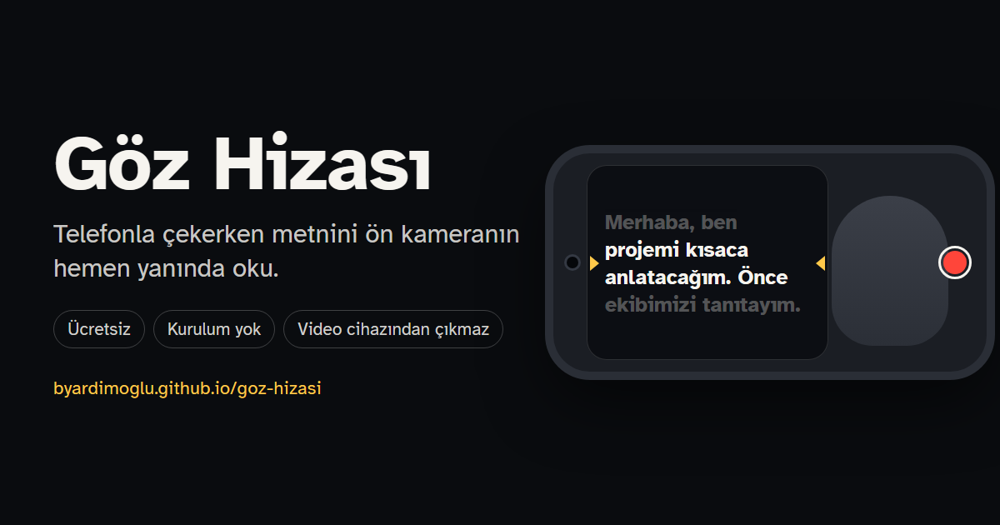

# Göz Hizası

Göz Hizası ücretsiz bir teleprompter. Telefonla video çekerken metnini ön kameranın hemen yanında okursun. Tarayıcıda çalışır, uygulama indirmen ya da üye olman gerekmez.

**Aç:** https://byardimoglu.github.io/goz-hizasi/

## Ne işe yarar

Kameraya konuşurken metni ezberlemek zordur. Ekrandan okumak da gözünü kameradan kaçırır. Göz Hizası metni ön kameranın olduğu kenarda akıtır. Sarı okların hizasındaki satırı okursan gözün lense yakın kalır ve izleyen sana bakıyormuşsun gibi görür.

## Özellikler

- Ön kamera önizlemesi ve kayıt, 1920×1080'e kadar
- Dakikadaki kelime sayısıyla hız ayarı ve okuma süresi tahmini
- Telefon yataysa metin kameranın olduğu kenarda, dikeyse üstte akar
- Metne dokununca akış durur ya da devam eder, parmağınla kaydırınca geri ya da ileri gider
- 3 saniyelik geri sayım; kayıt başlayınca metin kendiliğinden akar
- Birden çok metin tutabilirsin. Köşeli parantez içindeki notlar okunmaz, `//` duraklama yerini işaretler.
- Metni bilgisayarda yazıp bağlantıyla telefona gönderebilirsin
- Çekimi Fotoğraflar'a kaydedebilir ya da AirDrop ile gönderebilirsin
- Bilgisayarda web kamerasıyla da çalışır. Klavye kısayolları: boşluk akışı durdurur, ↑ ↓ hızı değiştirir, R kaydı başlatır.

## Gizlilik

Çektiğin video ve yazdığın metin cihazından çıkmaz. Sayfanın sunucusu yoktur ve hiçbir yere veri göndermez. Yazı tipi de sayfayla birlikte gelir. Metinler tarayıcının kendi belleğinde durur.

Bağlantıyla gönderilen metin, adresteki # işaretinden sonraki kısımda taşınır. Bu kısım sunucuya iletilmez.

## Nerede çalışır

iPhone'da iOS 14.5 ve üstündeki Safari için hazırlandı. Güncel Chrome, Edge ve Safari'de de çalışır.

Kamera yalnız https bağlantısında açılır. GitHub Pages bunu sağlar.

## Kendi kopyanı yayınlamak

Göz Hizası tek dosyalık bir web sayfasıdır (`index.html`). Depoyu çatallayıp (fork) GitHub Pages'i açman yeterli.

## Lisans

Kod MIT lisanslıdır (`LICENSE`). Atkinson Hyperlegible yazı tipi Braille Institute'a aittir ve SIL Open Font License 1.1 ile dağıtılır (`fonts/OFL.txt`).

Berk Yardımoğlu tarafından ücretsiz sunulur.
